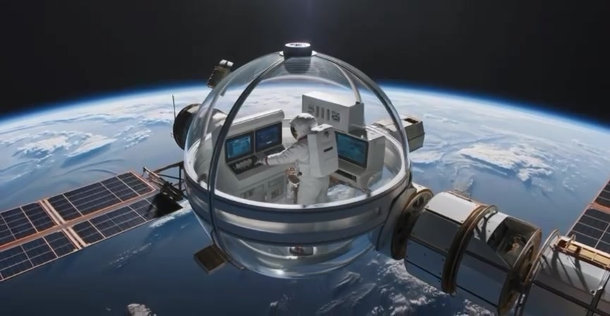

# الفقاعة الفضائية الذكية · Space Bubble

**تصوّر لنظام حماية وصيانة متنقّل في الفضاء**

[▶ مشاهدة الفيديو](media/%D9%81%D9%82%D8%A7%D8%B9%D9%87.mp4) · [فكرة المشروع](#الفكرة) · [التعاون](#التعاون)

## الفكرة

**الفقاعة الفضائية الذكية** فكرة لوحدة شفافة تحيط برائد الفضاء وتوفّر مساحة مقترحة للحماية والعمل أثناء مهام الصيانة خارج المنشأة الفضائية. يعرض الفيديو الوحدة متصلة بمنشأة مدارية، مع شاشات تحكم وإطلالة على الأرض.

الفيديو المرفق هو المرجع البصري للمشروع، وهذه الصفحة تلخّص ما يظهر فيه وتجمع ملفاته في مكان واحد.

## المكوّنات المقترحة

يسمّي المخطط في بداية الفيديو المكوّنات التالية:

| المكوّن | الغرض المقترح |
| --- | --- |
| هيكل مقاوم للصدمات الدقيقة | توفير حاجز حول مساحة العمل |
| عزل حراري متعدد الطبقات | المساعدة على تنظيم الظروف الحرارية |
| وحدة تحكم بيئي داخلية | متابعة البيئة داخل الوحدة والتحكم فيها |
| نظام إعادة تدوير المياه | دعم الاستفادة من المياه داخل الوحدة |

كما تظهر شاشات تحكم ورائد فضاء داخل الفقاعة، مع أجزاء من المنشأة والألواح الشمسية في محيطها.

## هدف المشروع

عرض فكرة الحماية والصيانة الفضائية بطريقة مختصرة وسهلة الفهم، وفتح المجال للتعاون على تحسين شرحها وتنظيم موادها البصرية.

**مرحلة المشروع:** تصور بصري أولي. لا تتضمن هذه النسخة نموذجًا هندسيًا أو تجارب تثبت قابلية التنفيذ.

## ملفات المشروع

- [الفيديو الأصلي — فقاعه.mp4](media/%D9%81%D9%82%D8%A7%D8%B9%D9%87.mp4): عرض مدته نحو 15 ثانية.
- [صورة المعاينة](assets/preview.jpg): لقطة مستخرجة من الفيديو نفسه.
- `README.md`: تعريف المشروع وشرح محتواه.

## التعاون

تنسيق المستودع: [@gaand1999](https://github.com/gaand1999).

حسابات الزميلات المدعوات للمشاركة:

- [@Janoo15](https://github.com/Janoo15)
- [@Aljowharah67](https://github.com/Aljowharah67)
- [@p44jgsdsz9-wq](https://github.com/p44jgsdsz9-wq)
- [@Deema9783](https://github.com/Deema9783)
- [@aldanhsaleh2010-pixel](https://github.com/aldanhsaleh2010-pixel)

يمكن للمشاركات اقتراح تحسينات على الوصف أو إضافة مواد توضيحية مرتبطة بالفكرة عبر تعديلات المستودع.
